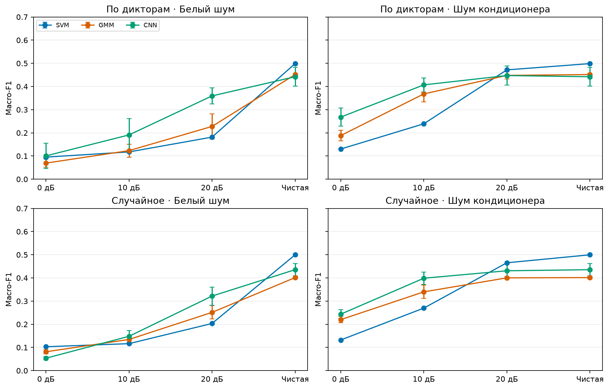
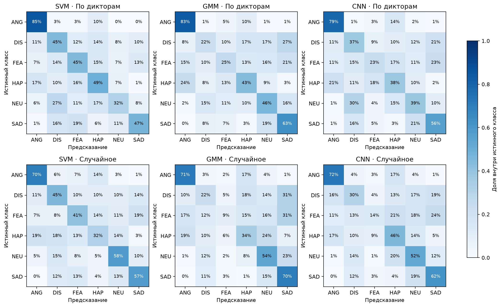

# Распознавание эмоций по голосу на CREMA-D

Галкин В. А. и Леончук Е. Д. · Основы машинного обучения

## Задача и данные

По записи речи требуется определить одну из шести эмоций. После аудита осталось 7 435 WAV от 91 диктора. В каждом протоколе 5 151 запись для обучения, 1 142 для валидации и 1 142 для теста. Разбиение по дикторам разделяет голоса между частями. Случайное разбиение стратифицировано по эмоциям.

## Признаки и модели

Сигнал переводится в моно и 16 кГц. После оконного преобразования Фурье спектральная мощность суммируется треугольными Mel-фильтрами, затем переводится в дБ. CNN получает окна 64 × 397, обучается с кросс-энтропией и усредняет softmax по окнам записи. Дискретное косинусное преобразование даёт MFCC. С производными первого и второго порядка получается 39 признаков на кадр.

GMM обучает отдельную смесь диагональных гауссиан на класс. E-шаг вычисляет ответственности компонент, M-шаг обновляет веса, средние и дисперсии. Предсказание максимизирует логарифмическую оценку записи при равных априорных вероятностях. SVM с ядром RBF использует среднее и стандартное отклонение каждого признака по кадрам. Стандартизация опирается на обучающую выборку.

Для диагональной смеси плотность кадра равна `p(x|c) = Σₖ πₖ N(x|μₖ, diag(σ²ₖ))`. Ответственность на E-шаге `rᵢₖ = πₖ N(xᵢ|μₖ, diag(σ²ₖ)) / p(xᵢ|c)`. На M-шаге вычисляются `Nₖ = Σᵢ rᵢₖ`, `πₖ = Nₖ/N` и `μₖ = Σᵢ rᵢₖxᵢ/Nₖ`. Дисперсия считается с теми же весами вокруг нового среднего. Нижняя граница дисперсии и расчёт в логарифмах стабилизируют алгоритм. RBF-ядро SVM задаётся формулой `exp(-γ‖x−z‖²)`.

## Эксперимент

Гиперпараметры выбраны на валидации разбиения по дикторам. Для каждого разбиения оценены три запуска CNN и GMM и один запуск SVM. Шум добавлен к одним и тем же тестовым записям при SNR 20, 10 и 0 дБ. Коэффициент шума вычисляется как `sqrt(P_signal / (P_noise * 10**(SNR/10)))`. Macro-F1 усредняет F1 шести классов. UAR усредняет полноту шести классов. Коды ANG, DIS, FEA, HAP, NEU, SAD означают гнев, отвращение, страх, радость, нейтральное состояние и грусть.

Выбранные гиперпараметры финальных моделей

- SVM · C = 100, gamma = 0.001
- GMM · n_components = 8, variance_floor = 0.01
- CNN · learning_rate = 0.0003, dropout = 0.4, weight_decay = 0.0001, batch_size = 32

## Чистая тестовая выборка

| Модель | Разбиение | Macro-F1 | UAR | Accuracy |
|---|---|---:|---:|---:|
| SVM | По дикторам | 0.499 | 0.504 | 0.509 |
| SVM | Случайное | 0.500 | 0.506 | 0.504 |
| GMM | По дикторам | 0.452 ± 0.005 | 0.472 ± 0.005 | 0.472 ± 0.005 |
| GMM | Случайное | 0.401 ± 0.005 | 0.435 ± 0.006 | 0.433 ± 0.005 |
| CNN | По дикторам | 0.442 ± 0.041 | 0.454 ± 0.033 | 0.456 ± 0.030 |
| CNN | Случайное | 0.436 ± 0.027 | 0.460 ± 0.020 | 0.458 ± 0.017 |

Разброс указан как выборочное стандартное отклонение между запусками.

## Устойчивость к шуму

| Модель | Разбиение | F1, белый шум 0 дБ | Падение, п.п. | F1, фон 0 дБ | Падение, п.п. |
|---|---|---:|---:|---:|---:|
| SVM | По дикторам | 0.095 | 40.4 | 0.130 | 36.9 |
| SVM | Случайное | 0.103 | 39.7 | 0.132 | 36.8 |
| GMM | По дикторам | 0.069 | 38.2 | 0.188 | 26.3 |
| GMM | Случайное | 0.081 | 32.0 | 0.220 | 18.1 |
| CNN | По дикторам | 0.101 | 34.1 | 0.268 | 17.4 |
| CNN | Случайное | 0.054 | 38.2 | 0.244 | 19.2 |

## Выводы и ограничения

- По дикторам. На чистой речи максимальный Macro-F1 у SVM (0.499).
- Случайное. На чистой речи максимальный Macro-F1 у SVM (0.500).
- При белом шуме 0 дБ на новых дикторах лидирует CNN (0.101).
- При шуме кондиционера 0 дБ на новых дикторах лидирует CNN (0.268).
- Состав теста различается между разбиениями. Разность результатов включает влияние состава записей.
- Результаты характеризуют постановочную англоязычную речь. Для шума использован один фон кондиционера и одна реализация каждой смеси.

## Время обработки

| Модель | Устройство | Инференс, мс на запись |
|---|---|---:|
| SVM | CPU | 0.99 |
| GMM | CPU | 0.87 |
| CNN | CUDA | 0.81 |

Замеры выполнены пакетами по 32 записи. Чтение признаков и построение шумовых смесей замерены отдельно и выполняются один раз на пакет для всех моделей. Таблица сравнивает фактические режимы запуска с указанными устройствами.

## Файлы результатов

[Сводка по всем 42 условиям](test_summary.csv) · [По запускам](test_per_seed.csv) · [По классам](test_per_class.csv) · [Замеры времени](timings.csv) · [Предсказания](test_predictions.csv)

[Распределения данных](dataset_distribution.png) · [Чистая и зашумлённая спектрограммы](spectrogram_noise.png) · [Кривые CNN](cnn_learning.png) · [Кривые EM](gmm_learning.png)
